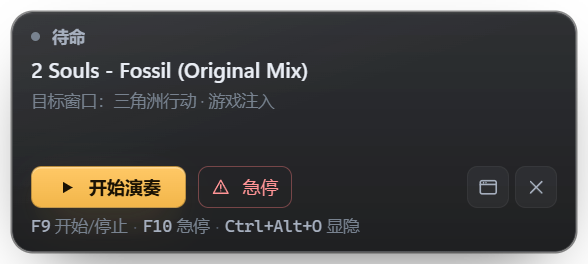
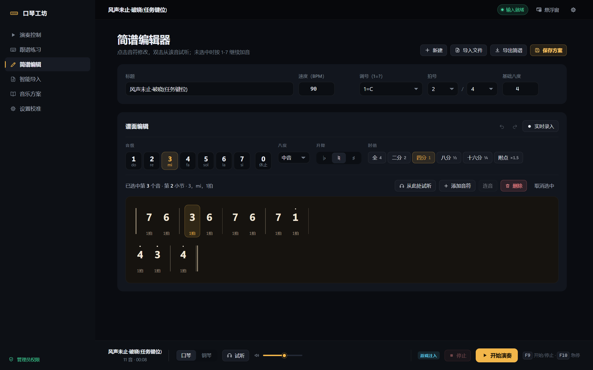
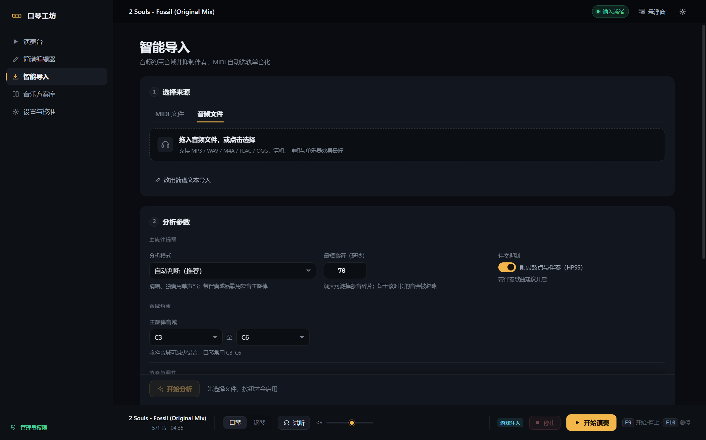
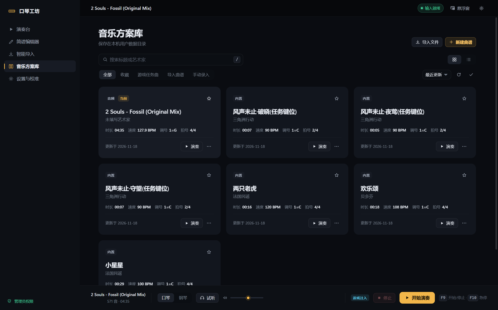
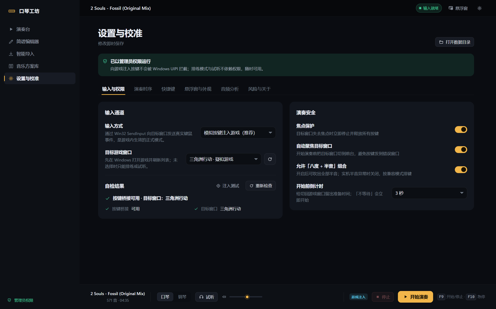
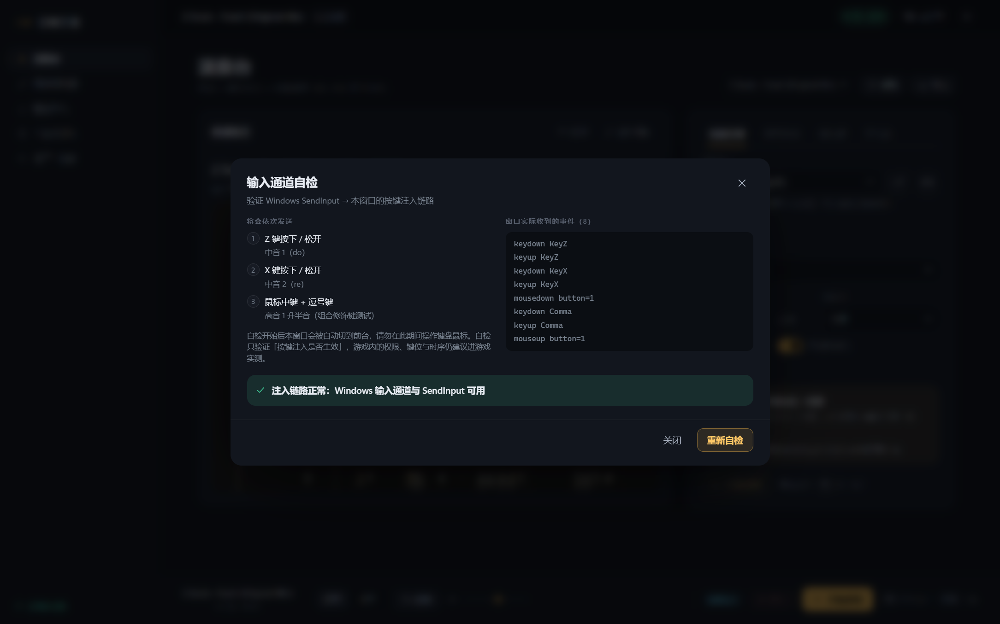

# 三角洲口琴工坊（Delta Harmonica Studio）

> 为《三角洲行动》「守夜人口琴」打造的 Windows 桌面自动演奏工作台（当前版本 v0.2.0）：
> **简谱录入 / 主旋律智能转谱 / 悬浮控制窗 / 可配置全局热键 / 双音色试听 / 音乐方案管理 / 高精度键鼠注入**，一站式把曲谱变成游戏里的琴声。


> ⚠️ **非官方工具，与腾讯 / 天美工作室群无关。** 游戏官方已公开将「第三方软件 / 脚本 / 鼠标宏自动操作」列为违规行为，最高封禁 10 年。本软件通过 Windows `SendInput` 模拟键鼠输入，不做任何反检测，**使用存在账号风险，请自行承担**。建议仅在个人练习、录制视频、朋友娱乐等场景使用，不要在排位/竞技对局中长期开启。

---

## ✨ 核心功能

| 模块 | 能力 |
|---|---|
| 🎼 简谱编辑器 | 数字简谱文本录入 / 粘贴，实时解析 + SVG 简谱排版；点击音符可视化改音级、八度、升降、时值、连音；拍号/时值自动校验；每行小节数/缩放可调 |
| 🎹 演奏台 | 乐谱一键生成物理键位计划（自动移调、八度折返、修饰键切换最少化 DP）；试听 / 排练 / 游戏注入三种模式；播放高亮 + 底部常驻播放条 |
| 🎧 智能导入 | MIDI 选轨单音化/量化/调性；音频**主旋律提取**（HPSS 伴奏抑制 + 谐波显著度 + Viterbi 平滑跟踪 + 音域约束），支持自动/单声部/复音模式；拖拽导入，生成后双音色试听 |
| 🪟 悬浮控制窗 | 无边框透明置顶小窗：当前曲谱、状态、倒计时、开始/停止/急停/回主界面；不抢游戏焦点（`focusable:false` + `showInactive`），支持托盘显隐 |
| ⌨️ 全局快捷键 | **可在设置页录制修改**：开始/停止、急停、悬浮窗显隐、显示主窗口；实时显示注册失败/冲突原因；录制期间自动暂停旧热键 |
| 🎵 双音色试听 | 内置「口琴」簧片音色（慢起音/渐强/颤音/气流声）与「钢琴」击弦音色；音量滑杆；编辑器/导入/悬浮窗/底部播放条统一试听 |
| 📚 音乐方案库 | 曲谱 JSON 方案本地保存/收藏/搜索/批量管理；导出简谱文本、键位谱（照着按）、方案 JSON |
| ⌨️ 键位注入 | 8 音键 + 鼠标左/中/右键修饰，扫描码注入、1ms 定时器精度、修饰键先按后音、绝对时间轴排程、失焦/光标离开自动停手、急停全量松键 |
| 🛡️ 安全设计 | 首次启动风险声明、管理员权限检测/UIPI 提示、目标窗口校验、鼠标光标位置保障、自检弹窗、托盘常驻 |

### 🆕 v0.2 新版 UI 与功能

- **全新应用外壳**：顶栏（当前曲谱/输入通道状态/热键/悬浮窗）、左侧导航、**底部常驻播放条**（双音色试听 + 音量 + 演奏进度 + 开始/停止），任何页面都能直接控制演奏。
- **悬浮控制窗**：游戏内不切界面即可开始/停止/急停（需游戏使用无边框窗口模式，独占全屏时窗口无法覆盖）。
- **可配置全局快捷键**：默认 `F9` 开始/停止、`F10` 急停、`Ctrl+Alt+O` 悬浮窗、`Ctrl+Alt+M` 主窗口；设置页可录制、即时生效、冲突提示。
- **主旋律优先的扒谱**：新增 `hpss.ts / salience.ts / melody.ts`（HPSS + 1~6 次谐波显著度 + 基频支撑度 + Viterbi 平滑 + 起音切分 + 八度校正），带伴奏歌曲可切「复音主旋律」模式并限制 C3–C6 音域。



| 简谱编辑器 | 智能导入 |
|---|---|
|  |  |

| 音乐方案库 | 设置与校准 |
|---|---|
|  |  |

输入链路自检（把真实 SendInput 事件注入本窗口验证）：



---

## 🚀 快速开始

### 环境要求

- Windows 10 / 11 x64
- Node.js ≥ 22.12（开发构建用；安装包用户无需 Node）
- 游戏《三角洲行动》PC 端（需已获得「守夜人口琴」并放入 EDC 工具包）

### 开发运行

```bash
npm install
npm run dev          # 开发模式（Vite + Electron）
npm run build        # 构建到 out/
npm start            # 构建产物启动
npm test             # 195 个单元测试
npm run typecheck    # TypeScript 全量类型检查
```

### 打包 Windows 安装包

```bash
npm run dist         # NSIS 安装包 + 便携版，输出到 release/
npm run dist:dir     # 只生成未打包目录，便于快速验证
```

打包说明：

- 产物：`release/delta-harmonica-0.2.0-x64.exe`（安装包）、`release/delta-harmonica-0.2.0-portable.exe`（便携版）。
- 可执行文件名为 `DeltaHarmonicaStudio.exe`：Electron 45 在中文 exe 文件名 / `requireAdministrator` 清单下会触发原生崩溃（已实测定位），因此 exe 用 ASCII 名、安装包以普通权限启动；窗口标题、快捷方式、安装界面仍是「三角洲口琴工坊」。
- 注入游戏前，点状态栏「以管理员重启」并在 UAC 中确认即可获得高权限（详见使用手册）。
- 国内网络如遇 Electron / electron-builder 二进制下载失败，项目内置 `.npmrc` 使用 npmmirror 镜像。

---

## 🎮 使用流程（游戏内演奏）

1. **准备口琴**：完成长弓溪谷佐拉任务链拿到「守夜人口琴」，局外放入 EDC 工具包；局内长按 `6` 打开轮盘取出口琴，进入手动演奏界面。
2. **打开软件**：以管理员身份运行（状态栏显示绿色「管理员权限」）。
3. **选择窗口**：演奏台 → 目标窗口 → 刷新 → 选择标题含「三角洲行动」的窗口（进程名 `DeltaForceClient-Win64-Shipping.exe`）；首次可先点「输入通道自检」。
4. **选曲**：从方案库选择/启动时自动载入最近曲谱，或到「智能导入」生成新谱。
5. **开始演奏**：确认安全设置 →「开始演奏」，倒计时内切回游戏；默认 `F9` 开始/停止、`F10` 紧急停止并释放所有按键（可在设置页自定义）。
   - 软件会自动把鼠标移入游戏窗口（低/高八度、半音依赖鼠标按键）；演奏期间请勿把鼠标移出游戏。
   - 开启「焦点保护」后，游戏失焦或光标离开窗口会立即停手。
   - 需要游戏内快捷操作时，打开「悬浮窗」（默认 `Ctrl+Alt+O` 显隐）；游戏需为**无边框窗口**模式，独占全屏时悬浮窗无法覆盖。若悬浮窗按钮不便点击，直接用全局快捷键。

> 详细步骤、故障排查、简谱语法请见 [docs/USER_GUIDE.md](docs/USER_GUIDE.md)。

---

## 🧠 技术栈与架构

**Electron 45 + React 19 + TypeScript 5.9 + Vite 8（electron-vite）**

```
┌─────────────────────────── 渲染进程（React） ───────────────────────────┐
│ 简谱编辑器 / 演奏台 / 智能导入 / 方案库 / 设置校准                      │
│   @core（纯 TS，可单测）                                                 │
│   ├─ model：简谱数据模型、音高换算、口琴键位与 38 音音域                 │
│   ├─ score/dsl：简谱文本解析 ↔ 序列化（round-trip）                     │
│   ├─ music：连音合并、调性检测（Krumhansl）                              │
│   ├─ import：MIDI 导入、音频转谱 → 简谱                                  │
│   ├─ audio：YIN 基频 / 谱通量起音 / 节拍估计 / 主旋律提取（HPSS+显著度+Viterbi） │
│   └─ instrument/plan：移调 + 折返 + 修饰键 DP 最优排键 + 毫秒事件计划    │
│ 试听：Web Audio 双音色合成（口琴簧片 / 钢琴击弦）+ 全局音量              │
│ 状态：Preview / Performance 上下文（任何页面可试听/开始/停止）           │
└───────────────────────────────┬──────────────────────────────────────────┘
                    preload（contextBridge 白名单 IPC）
┌───────────────────────────────┴──────────── 主进程 ─────────────────────┐
│ PlaybackController：绝对时间轴 + sleep/自旋混合等待 + 焦点/光标看门狗     │
│   + 失败全量松键                                                         │
│ OverlayWindowManager：透明置顶悬浮窗（focusable:false 不抢焦点）          │
│ HotkeyManager：可配置全局快捷键（冲突检测/录制暂停）                      │
│ AppTray：托盘菜单（显示主窗口/悬浮窗/开始停止/退出）                      │
│ native/win32（koffi 动态调用 user32/winmm）：                            │
│   SendInput（键盘用物理扫描码）、窗口枚举/进程名识别、AttachThreadInput  │
│   切前台、光标位置/窗口矩形校验、timeBeginPeriod(1)                       │
│ storage：settings.json + scores/*.dfh.json（用户数据目录，原子写入）      │
└──────────────────────────────────────────────────────────────────────────┘
```

### 键位模型（PC，S11/S12 实测与社区资料交叉验证）

| 简谱 | 1 | 2 | 3 | 4 | 5 | 6 | 7 | 高音1 |
|---|---|---|---|---|---|---|---|---|
| 按键 | Z | X | C | V | B | N | M | , |

- 鼠标**左键**=降八度、**右键**=升八度、**中键**=升半音；按多久响多久；单音演奏。
- 8 个音键 + 3 个鼠标修饰键组合，覆盖 **C3–C#6 共 38 个连续半音**。
- 软件会把绝对音高自动映射到「修饰键最少 + 切换最少」的物理组合；超音域自动八度折返，或整体移调。

### 演奏时序（可调）

| 参数 | 默认 | 说明 |
|---|---|---|
| 修饰键稳定时间 | 24ms | 先按住鼠标键，再按音符键 |
| 相邻音释放间隔 | 12ms | 避免两个音粘连 |
| 单音最短保持 | 40ms | 低于该值游戏可能不判定 |
| 修饰键切换间隔 | 6ms | 换音时调整鼠标键的间隔 |
| 开头留白 | 90ms | 保证第一个音的修饰键提前量 |
| 定时精度 | 1ms | `timeBeginPeriod(1)` + 4ms 自旋等待 |

---

## 📁 项目结构

```
src/
  core/                 # 纯 TypeScript 核心（无 Electron/DOM 依赖，全部可单测）
    model/              # 简谱模型、音高、口琴键位
    score/dsl.ts        # 简谱文本 DSL 解析 / 序列化
    music/              # 时间线、连音合并、调性检测
    instrument/plan.ts  # 移调/折返/修饰键 DP/毫秒级输入事件计划
    import/             # MIDI 导入、转谱
    audio/              # YIN、起音、节拍、HPSS、显著度、主旋律提取
    export/             # 键位谱导出
  main/                 # Electron 主进程（窗口、IPC、存储、注入、排程器、悬浮窗、热键、托盘）
  preload/              # contextBridge API
  renderer/             # React 界面（页面 / 组件 / 双音色试听 / 悬浮窗 UI）
  shared/               # 共享类型、默认设置、内置曲库
tests/                  # 195 个 vitest 单元测试
docs/                   # 方案文档、使用手册、调研报告、截图
scripts/                # 探针、游戏内测试、截图、启动包装器
```

---

## 🧪 测试与验收

- `npm test`：**195 passed / 1 skipped**（跳过项为手动开启的性能烟测）
  - 核心模型/音高/键位/38 音音域、简谱 DSL round-trip、连音与拍号校验
  - 演奏编排：事件时间排序、无和弦、修饰键状态正确、结束全量松键、极快节奏过滤
  - MIDI 导入：选轨/单音化/量化/调性/容错
  - 音频转谱：合成音阶、静音/噪声、半音/八度切分、120BPM 节拍
  - **主旋律提取（16 项）**：纯旋律、旋律+变化和弦/固定和弦（含八度重叠）、HPSS 打击抑制、音域约束、auto/强制模式、颤音/同音重复切分、静音/噪声、60s 44.1kHz 性能 0.72s
  - 简谱 SVG 布局：小节线、减时线、八度点、连音、1000 音符性能
- 输入链路端到端验证：应用内注入真实 Z/X/中键/逗号，窗口成功收到事件（见上方截图）。
- **游戏内实机验证（真实对局、手持口琴手动界面）**：键盘 1/2/3、中键升半音、右键高八度、左键低八度、八度+半音组合全部发声正确、无开火/开镜副作用；`SendInput` 路径确认可用（详见 [docs/PLAN.md](docs/PLAN.md) 第 13 节）。
- **软件完整自动演奏验收**：自动识别游戏窗口 → 3 秒倒计时 → 24/24 输入事件按时间轴发出（7.57 秒，含右键高音）→ 正常结束；实机听到的旋律、节奏、八度均正确，无多余动作。
- **v0.2 悬浮窗/热键验收**：悬浮窗透明渲染通过（角落 alpha≈0、卡片 α≈240）并截图；悬浮窗「开始」按钮 → `overlay command=toggle-play` IPC 链路验证通过；4 个全局热键默认值（F9/F10/Ctrl+Alt+O/Ctrl+Alt+M）本机全部注册成功。
- 本机实测：`SendInput`（koffi + 物理扫描码）在 Electron 45 下可用；`AttachThreadInput + SetForegroundWindow` 可稳定切前台。
- `npm run typecheck` 全绿；`npm run build` 通过。

---

## ⚠️ 已知限制

- 游戏内绝对音高未公开，软件按「音级 + 八度偏移」相对建模（约定 1=C4=60），不影响游戏实际发声。
- 键位表为固定预设（支持自检确认）；「自定义逐键重映射」在路线图中。
- **悬浮窗需要游戏使用「无边框窗口」模式**；独占全屏（Exclusive Fullscreen）下系统不允许其他窗口覆盖，此时请改用全局快捷键。
- 悬浮窗窗口设为不可聚焦（focusable:false）以避免打断游戏焦点；按钮点击的实机手感建议首次使用时验证，若不可点则用全局快捷键。
- 全局快捷键可能被系统/游戏/其他软件占用：设置页会显示每项的注册状态，冲突时换一个组合即可；录制新热键时会临时暂停旧热键。
- 音频主旋律提取仍是传统 DSP：强混响、旋律被伴奏掩蔽、主旋律在低音区时可能跳八度或漏音；带伴奏歌曲建议切「复音主旋律」模式并开启伴奏抑制，成品歌优先 MIDI/简谱。
- MIDI 变速曲目目前按第一段 BPM 处理（会提示）；复杂和弦只取单声部主旋律。
- Arduino/串口硬件输出仅预留接口（尚未启用）。
- 游戏版本若改动键位/机制，需要更新键位预设并在实机校准。

## 🗺️ 路线图

1. 键位自定义/逐键校准向导、组合键叠加模式实机校准流程。
2. 键位谱导入（ZXCVBNM 串 → 简谱）。
3. 悬浮窗多显示器/高 DPI 适配、鼠标穿透开关；WAV/MIDI 导出。
4. 可选接入 basic-pitch（ONNX）或人声分离，进一步改善带伴奏歌曲扒谱。
5. Arduino/Leonardo HID 硬件输出（串口协议 + Web Serial 面板）。
6. 游戏窗口截图/OCR 辅助确认演奏界面状态（仅本地，不读内存）。

---

## 📚 调研与方案文档

- [技术方案与架构决策](docs/PLAN.md)
- [使用手册与故障排查](docs/USER_GUIDE.md)
- [游戏机制调研报告](docs/research/game-harmonica.md)
- [技术选型调研报告](docs/research/tech-stack.md)

参考资料（外部，仅供研究引用）：腾讯/天美官方公告、17173/九游/游侠/3DM 攻略、掘金实战文章、B 站口琴教程、GitHub 同类开源项目等，详见调研报告。

---

## 📄 License

代码以 MIT 许可发布（见 [LICENSE](LICENSE)）。第三方依赖遵循其各自许可（Electron MIT、React MIT、koffi MIT、@tonejs/midi MIT）。
游戏内截图/曲谱资料的版权归原权利人，仅作研究引用；内置曲库只包含公有领域与传统民谣，任务曲谱为社区整理的键位顺序并已标注来源。

**本项目仅供个人学习、练习与娱乐，请勿用于商业代练、账号交易或任何破坏游戏公平性的用途。**
