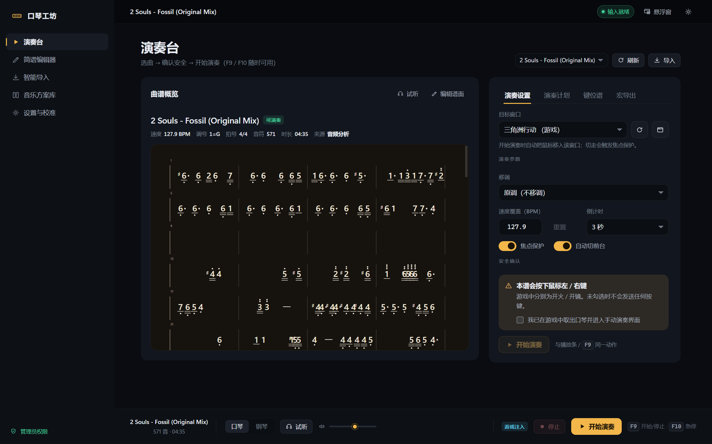

# 三角洲口琴工坊（Delta Harmonica Studio）

三角洲口琴工坊是一个跨平台桌面应用，用于把简谱、MIDI 或音频转换成《三角洲行动》中「守夜人口琴」的按键序列并自动演奏。它同时提供不依赖游戏的练习模式、真实采样试听、曲谱管理，以及 AutoHotkey、罗技 G HUB 和 CSV 格式的鼠标宏导出。

Windows 版可以把键鼠事件注入游戏；macOS 与 Linux 版保留编辑、导入、练习、试听、方案库与宏导出，演奏以排练模式运行（游戏本身只有 Windows 客户端，平台差异见[平台支持](#平台支持)）。

软件不修改游戏文件，也不读取游戏内存；向游戏发送的输入全部通过 Windows 键鼠输入 API 模拟完成。

- 平台：Windows 10 / 11 x64（完整功能）；macOS 12+（Intel / Apple Silicon）与 Linux x64（无游戏注入）
- 许可：MIT

## 免责声明

本项目为非官方工具，与腾讯及天美工作室群无关。游戏官方已将第三方软件、脚本、鼠标宏等自动操作列为违规行为，最高封禁 10 年。Windows 版通过 `SendInput` 模拟键鼠输入，不包含任何反检测机制，使用存在账号风险，请自行承担；macOS / Linux 版不注入按键，但导出的宏文件在 Windows 上使用同样受此约束。建议仅在个人练习、录制视频、朋友娱乐等场景使用，不要在排位或竞技对局中长期开启。

## 功能

- **曲谱编辑**：可视化编辑音符的音级、八度、升降、时值与连音；选中音符后可修改属性，未选中时按数字键直接追加音符；小节线随时值自动重排；支持撤销 / 重做，以及从指定音符开始试听。
- **实时录入**：按游戏键位（`Z X C V B N M ,` 加鼠标左 / 中 / 右键）实时演奏，按 BPM 量化成简谱；支持 1/4、1/8、1/16 拍网格、监听与撤销；浮动录制条不改变页面布局。
- **智能导入**：MIDI 可选轨、单音化、量化并检测调性；音频转谱以主旋律提取为目标，使用 HPSS 伴奏抑制、谐波显著度、基频支撑度、Viterbi 平滑与音域约束，支持自动、单声部、复音三种模式；支持拖拽导入。
- **演奏编排**：把乐谱转换成物理键位计划，自动移调、超音域八度折返，并以动态规划选择修饰键切换最少的按法；支持试听、排练、游戏注入三种模式。
- **练习模式**：任选小节生成横向滚动或下落式谱面，支持全屏专注、50%–125% 变速、循环和等待按键；按音准与拍点逐音判定，实时统计准确率、连击与平均偏差。
- **悬浮控制窗**：无边框透明置顶小窗，显示当前曲谱、状态与倒计时，可开始、停止、急停和返回主界面；窗口不获取焦点，避免打断游戏。
- **全局快捷键**：开始 / 停止、急停、悬浮窗显隐、主窗口显示均可录制修改；注册失败或冲突时显示原因，录制期间自动暂停旧热键。
- **双音色试听**：内置 VCSL Hohner Special 20 口琴与 Alexander Holm 的 Salamander 三角钢琴真实采样，编辑器、导入、练习、悬浮窗和播放条共用同一套音源与音量设置。
- **方案库与导出**：曲谱方案以 JSON 保存在本地，支持收藏、搜索和批量管理；可导出简谱文本、键位谱（照着按）与方案 JSON。
- **鼠标宏导出**：生成 AutoHotkey v1 / v2 脚本、罗技 G HUB Lua 脚本、通用 CSV 时序表和触发键位表；宏与软件内演奏使用同一份时间轴，不会出现两边节奏不一致的问题。
- **键位注入与安全**：使用物理扫描码发送按键，鼠标键作为八度与半音修饰；绝对时间轴排程、1ms 定时器精度、修饰键先按后音、失焦或光标离开窗口自动停手、急停时全量松键。

## 界面设计

界面按「夜间乐器工作台」的思路组织：石墨底色、单一琥珀聚光灯、青蓝系统信号，用排版和留白分层，而不是用卡片和描边堆叠。

- **令牌**：颜色、字号、间距、圆角、动效、层级与骨架尺寸集中定义在 `src/renderer/src/styles/tokens.css`，页面不写裸色值。
- **基元**：按钮、卡片、表单、标签页、分段控件、徽标、提示、谱面与弹窗等外观定义在 `components.css`，页面只负责组合。
- **外壳**：232px 侧栏、48px 顶栏、72px 底部播放条与启动页由 `layout.css` 定义，页面专属样式放在各自的 `page-*.css`。
- **层级**：实心琥珀主按钮全应用唯一，用于播放条的「开始演奏」；页面主操作使用琥珀色调按钮。同一状态只提示一次（输入通道、权限、未保存）。
- **减法**：卡片不描边、标签不加底色、不使用页面眉标与卡片标题图标；曲名只在顶栏出现，音符数与时长只在播放条出现。
- **可访问性**：全站提供 `:focus-visible` 焦点环；弹窗支持 `Esc` 关闭、焦点回收与 Tab 循环；Tab 组件带 `role`、`aria-selected` 和方向键操作；正文对比度不低于 4.5:1。
- **验收**：界面改动需通过类型检查、单元测试与构建，再按设计清单逐页截图核对。

## 截图



更多界面截图见 [`docs/screenshots/`](docs/screenshots/)。

## 平台支持

| 能力 | Windows 10 / 11 x64 | macOS 12+ | Linux x64 |
|---|---|---|---|
| 简谱编辑、智能导入、方案库 | ✅ | ✅ | ✅ |
| 跟谱练习、双音色试听 | ✅ | ✅ | ✅ |
| 宏导出（AHK / G HUB / CSV / 触发表） | ✅ | ✅ | ✅ |
| 向游戏注入键鼠 | ✅（需管理员） | — | — |
| 全局快捷键 / 悬浮窗 / 托盘 | ✅ | ✅ | ✅（Wayland 受限） |
| 管理员提权（UAC） | ✅ | — | — |

《三角洲行动》PC 端只有 Windows 客户端，Win32 `SendInput` / UIPI 也没有等价的跨平台实现，因此 macOS / Linux 版不提供游戏注入：界面会说明原因，输入方式固定为排练模式，编辑、导入、练习、试听与宏导出保持完整可用。

安装包与已知限制：

- **Windows**：NSIS 安装包 + 便携版，可执行文件名 `DeltaHarmonicaStudio.exe`；首次使用建议以管理员身份运行，否则游戏会静默丢弃模拟按键。
- **macOS**：`.dmg` + `.zip`，同时提供 Intel（x64）与 Apple Silicon（arm64）构建。未配置 Developer ID 时产物未签名、未公证（arm64 已做 ad-hoc 签名），首次打开请右键「打开」，或在「系统设置 → 隐私与安全性」中允许。
- **Linux**：`.AppImage` + `.deb`。AppImage 需要先 `chmod +x`；Ubuntu 22.04+ 若提示缺少 FUSE，可安装 `libfuse2` 或使用 `--appimage-extract-and-run`。Wayland 下悬浮窗的位置与置顶由合成器决定，独占全屏时可能不可见；X11 下行为与 Windows 一致。
- 宏文件本身面向 Windows 宏软件（AutoHotkey / 罗技 G HUB）；在 macOS / Linux 上可以导出、查看与按 CSV 时序表自行录入。

构建、签名与发布细节见 [平台支持与发布](docs/PLATFORM_SUPPORT.md)。

## 运行环境

- Windows 10 / 11 x64、macOS 12+（Intel / Apple Silicon）、主流 Linux 发行版 x64
- Node.js 22.12 或更高版本（以 `package.json` 的 `engines` 字段为准）
- 《三角洲行动》PC 端（仅 Windows），并已获得「守夜人口琴」

## 安装与运行

### 从源码运行

```bash
npm install
npm run dev          # 开发模式（Vite + Electron）
npm run build        # 构建到 out/
npm start            # 运行构建产物
```

国内网络下载 Electron / electron-builder 二进制失败时，项目内置的 `.npmrc` 会使用 npmmirror 镜像。

### 构建安装包

```bash
npm run dist:win     # Windows：NSIS 安装包 + 便携版
npm run dist:mac     # macOS：dmg + zip（默认当前架构；双架构用 -- --x64 --arm64）
npm run dist:linux   # Linux：AppImage + deb
npm run dist         # 按当前操作系统选择目标
npm run dist:dir     # 只生成未打包目录，便于快速验证
```

安装包输出到 `release/`，命名如下：

| 平台 | 产物 |
|---|---|
| Windows | `release/delta-harmonica-<version>-x64.exe`（安装包）、`release/delta-harmonica-<version>-portable.exe`（便携版） |
| macOS | `release/delta-harmonica-<version>-mac-x64.dmg` / `.zip`、`release/delta-harmonica-<version>-mac-arm64.dmg` / `.zip` |
| Linux | `release/delta-harmonica-<version>-linux-x64.AppImage`、`release/delta-harmonica-<version>-linux-x64.deb` |

可执行文件名称为 `DeltaHarmonicaStudio`（Windows 下为 `DeltaHarmonicaStudio.exe`）：可执行文件使用 ASCII 名以规避中文文件名下的原生崩溃风险；窗口标题、快捷方式与安装界面仍显示「三角洲口琴工坊」。

打包必须在目标系统上执行（macOS 的 dmg / 公证依赖 Xcode 工具，Linux 的 AppImage / deb 依赖 Linux 工具链）。仓库内置 [GitHub Actions 发布工作流](.github/workflows/release.yml)，推 `v*` 标签即可在 Windows、macOS（Intel / Apple Silicon）与 Linux 上分别构建并汇总到 Release。

## 使用

### 游戏内准备

1. 完成长弓溪谷佐拉任务链获得「守夜人口琴」，局外放入 EDC 工具包。
2. 局内长按 `6` 打开轮盘取出口琴，进入演奏界面。
3. 演奏界面下按 `R` 切到手动演奏；本软件模拟的是手动按键，官方自动演奏只能播放已解锁曲目，不能导入自定义谱。
4. 将系统输入法切到英文 / 半角，避免逗号被输入法拦截成全角。

### 演奏流程

1. Windows 版建议以管理员身份运行本软件。仅试听或排练时不需要管理员权限；macOS / Linux 版没有注入入口，直接进入排练。
2. 在演奏台选择目标窗口：刷新后选择标题包含「三角洲行动」的窗口（进程名 `DeltaForceClient-Win64-Shipping.exe`）；首次使用可先运行「输入通道自检」。此步骤仅 Windows 版可用。
3. 从方案库选择曲谱（启动时会自动载入最近使用的曲谱），或在「智能导入」中由 MIDI / 音频生成曲谱。
4. 如需先熟悉按键，可在「练习」中慢速跟谱。练习只监听本窗口的键盘与鼠标，不会向游戏发送按键。
5. 在演奏台点击「开始演奏」，倒计时内切回游戏。默认 `F9` 开始 / 停止，`F10` 紧急停止并释放所有按键。macOS / Linux 上同一入口以排练模式走时间轴。
6. 演奏期间不要将鼠标移出游戏窗口，八度与半音依赖鼠标按键。开启焦点保护后，游戏失焦或光标离开窗口会立即停手。
7. 可使用悬浮窗（默认 `Ctrl+Alt+O`）在游戏内控制演奏。游戏需使用无边框窗口模式，独占全屏时悬浮窗无法覆盖；按钮不便点击时直接使用全局快捷键。

### 权限与安全

- 游戏以管理员权限运行，Windows UIPI 会静默丢弃低权限进程的模拟输入，因此注入前需要提权（仅 Windows）。
- 程序默认以普通权限启动，在应用内点击「以管理员重启」并在 UAC 中确认即可。
- 首次启动会显示风险声明，需确认后才能进入；macOS / Linux 版会说明本平台不注入按键。
- 输入通道自检会向本窗口真实注入键盘、鼠标中键与组合键事件，用于确认注入链路可用（仅 Windows）。
- 急停会立即停止排程并释放所有按下的按键和鼠标键。

简谱语法、失败模式与完整的产品设计见 [产品设计文档](docs/PRODUCT_DESIGN.md)。

## 练习模式

练习模式不启动游戏也能跟谱，只监听本窗口的键盘与鼠标，不会向游戏发送按键。

- **片段**：可设置起始与结束小节，跨小节自动切片；连音合并，超音域自动折返；默认练习整首。
- **谱面**：横向滚动时音符从右向左经过判定线；下落式按 8 个音键分列、纵向表示时间。练习中可随时切换。
- **全屏**：按 `F11` 或点击「全屏练习」隐藏侧栏、顶栏与播放条；`Esc` 在练习中先结束本次练习，再按一次退出全屏。
- **变速与循环**：速度范围 50%–125%，显示实际 BPM；可循环当前片段反复练习，每遍重新经过预备拍。
- **判定方式**：计时判定按时间滚动，判定窗口为 ±150ms；等待按键模式在每音停住，按对音高才继续，适合认谱和找键位。
- **判定等级**：完美 ±55ms、优秀 ±100ms、良好 ±150ms；失误与错音分开统计，同音高的不同按法都算正确。
- **反馈**：实时显示准确率、连击、平均偏差与判定分布；节拍器重拍加高音，按下音键立即用当前采样发声，失误另有低声提示。
- **一致性**：练习与演奏台共用移调设置，练习时用的按法就是游戏中的按法。

## 鼠标宏导出

演奏台和方案库都能导出以下文件。导出内容基于当前的移调、速度、八度折返与按法，与软件内演奏使用同一份 PlaybackPlan。

- **AutoHotkey v1 脚本**：触发键默认 `F9`，可改为鼠标侧键 `XButton1` / `XButton2`；使用物理扫描码发送键盘、鼠标按键作为修饰，按绝对时间轴逐步延时，`F10` 重新加载脚本即中止。
- **AutoHotkey v2 脚本**：同样的功能，使用 v2 语法；v1 与 v2 脚本互不兼容，需按本机安装的版本选择。
- **罗技 G HUB Lua 脚本**：绑定鼠标侧键（默认前进侧键），通过 `PressKey` / `PressMouseButton` 加 `Sleep` 逐事件回放；按一次开始，再按一次中止。
- **通用 CSV 时序表**：每行记录时间、距上一事件的延时、按下或松开、键盘或鼠标、键位与扫描码，适合支持「按键 + 延时」的宏编辑器。
- **Markdown 触发键位表**：包含全音域 38 个半音的推荐触发映射、本曲逐音触发表、组合使用统计，以及宏软件兼容性对照。

宏由宏软件执行，与鼠标品牌无关。宏文件本身面向 Windows 宏软件：macOS / Linux 版可以导出与查看，并按 CSV 时序表在其他工具中录入。目前品牌专属格式中只有罗技 G HUB 公开提供 Lua 引擎；雷蛇 Synapse、海盗船 iCUE、赛睿 GG、血手宝典、冰豹 Swarm、HyperX NGENUITY 的宏只能录制并保存在私有配置中，没有稳定的可导入格式，因此跨品牌场景建议使用 AutoHotkey，或按 CSV 时序表手工录入。

使用宏时，宏软件需要以管理员权限运行，游戏建议使用无边框窗口；不要同时启动软件内演奏，若本软件正在运行，建议把宏触发键改为鼠标侧键，避免与 `F9` 全局热键冲突。

## 键位映射

| 简谱 | 1 | 2 | 3 | 4 | 5 | 6 | 7 | 高音 1 |
|---|---|---|---|---|---|---|---|---|
| 按键 | Z | X | C | V | B | N | M | , |

- 鼠标左键为降八度，右键为升八度，中键为升半音；按住多久就响多久，单音演奏。
- 8 个音键与 3 个鼠标修饰键组合，覆盖 C3–C#6 共 38 个连续半音。
- 软件会把绝对音高映射到「修饰键最少、切换最少」的物理组合；超出音域时自动八度折返或整体移调。

## 演奏时序

以下为默认值，可在设置页的「演奏时序」中调整，用于控制游戏对模拟输入的判定稳定性：

| 参数 | 默认 | 说明 |
|---|---|---|
| 修饰键稳定时间 | 24ms | 先按住鼠标键，再按音符键 |
| 相邻音释放间隔 | 12ms | 避免两个音粘连 |
| 单音最短保持 | 40ms | 低于该值游戏可能不判定 |
| 修饰键切换间隔 | 6ms | 换音时调整鼠标键的间隔 |
| 开头留白 | 90ms | 保证第一个音的修饰键提前量 |
| 定时精度 | 1ms | `timeBeginPeriod(1)` 配合自旋等待 |

## 架构

应用按 Electron 的三层结构组织，核心逻辑全部放在不依赖 Electron 与 DOM 的纯 TypeScript 模块中，便于单测和复用。

### 渲染进程

React 界面负责曲谱编辑、演奏台、练习、导入、方案库与设置。全局的 Preview / Performance 上下文让任何页面都能试听、开始或停止演奏；底部播放条常驻，负责试听、音量与演奏进度。

### 核心逻辑

`src/core` 包含简谱数据模型、音高与键位换算、简谱 DSL 的解析与序列化、连音合并、调性检测、MIDI 与音频转谱、主旋律提取、练习切片与判定，以及移调、折返、排键和毫秒级输入事件计划。

### 主进程

- `PlaybackController`：绝对时间轴排程、sleep / 自旋混合等待、焦点与光标看门狗、失败时全量松键。
- `OverlayWindowManager`：透明置顶悬浮窗，以 `focusable: false` 与 `showInactive` 避免抢占游戏焦点。
- `HotkeyManager`：可配置全局快捷键，负责冲突检测与录制期间暂停注册。
- `AppTray`：托盘菜单，显示主窗口 / 悬浮窗、开始停止与退出。
- `storage`：`settings.json` 与 `scores/*.dfh.json` 写入用户数据目录（Windows 下通常为 `%APPDATA%\三角洲口琴工坊`），使用原子写入。

### 输入链路

原生模块通过 koffi 动态调用 `user32` / `winmm`，使用物理扫描码发送 `SendInput`，并借助窗口枚举、进程名识别、`AttachThreadInput` 与 `SetForegroundWindow` 切换前台；同时校验光标位置和窗口矩形，通过 `timeBeginPeriod(1)` 提高定时精度。该模块只在 Windows 上加载：macOS / Linux 会把它降级为空实现，界面据此把注入入口置灰并自动切到排练模式，避免原生模块缺失导致应用无法启动。

### 预加载与 IPC

预加载脚本通过 `contextBridge` 暴露白名单 API，渲染进程不直接访问 Node.js 或原生模块。

## 项目结构

```
src/
  core/                 # 纯 TypeScript 核心（不依赖 Electron / DOM，可单测）
    model/              # 简谱模型、音高换算、口琴键位
    score/              # 简谱 DSL 解析 / 序列化、编辑器顺序模型
    music/              # 时间线、连音合并、调性检测
    instrument/         # 移调、折返、排键与毫秒级输入事件计划
    import/             # MIDI 导入与转谱
    audio/              # 基频、起音、节拍与主旋律提取
    export/             # 键位谱、鼠标宏与触发键位表导出
    practice/           # 练习切片、变速时间轴与逐音判定
  main/                 # Electron 主进程（窗口、菜单、IPC、存储、注入、悬浮窗、热键、托盘）
  preload/              # contextBridge API
  renderer/             # React 界面、试听、练习与悬浮窗
  shared/               # 共享类型、默认设置、平台能力、内置曲库
resources/audio-samples # 随安装包分发的口琴 / 钢琴采样
assets/icon.png         # 应用图标（electron-builder 的 buildResources，自动转 Windows .ico / macOS .icns）
tests/                  # Vitest 单元测试
docs/                   # 产品设计、平台支持文档与界面截图
scripts/                # 开发、探针、截图、签名与打包辅助脚本
.github/workflows/      # Windows / macOS / Linux 三端 CI 与发布工作流
```

`out/`（electron-vite 构建）、`release/`（安装包）、`artifacts/`（截图与验收日志）以及旧版 `build/` 目录都是生成物，已在 `.gitignore` 中忽略。

技术栈：Electron、React、TypeScript、electron-vite、Vitest，以及用于键盘鼠标注入的 koffi 和用于 MIDI 解析的 `@tonejs/midi`。

## 开发与测试

```bash
npm test             # 单元测试（Vitest）
npm run typecheck    # TypeScript 全量类型检查
```

提交前建议依次运行 `npm run typecheck`、`npm test` 和 `npm run build`。

单元测试覆盖核心数据模型与音高换算、简谱 DSL 的 round-trip、连音与拍号校验、可视化编辑与实时录入的顺序整理、排键与事件计划、MIDI / 音频导入、主旋律提取、练习判定、鼠标宏导出，以及界面设计令牌的对比度。测试只验证纯逻辑与可静态检查的约束，涉及游戏窗口的输入链路仍需通过应用内自检和实机演奏确认。

需要手动确认的部分包括：输入通道自检能收到真实 `SendInput` 事件；真实对局中 8 个音键、左右八度、中键半音与组合键发声正确，且没有开火、开镜等副作用；完整演奏时事件按计划发出，并在结束时释放所有按键。

界面样式统一使用 `src/renderer/src/styles/tokens.css` 中的设计令牌，不在页面中直接写颜色值。

### 命名约定

- 产品英文名：Delta Harmonica Studio
- 仓库与 npm 包名：delta-harmonica-studio
- 可执行文件：DeltaHarmonicaStudio（Windows 下为 `DeltaHarmonicaStudio.exe`）
- 安装包前缀：delta-harmonica-
- macOS / Linux 产物：`delta-harmonica-<version>-mac-<arch>`、`delta-harmonica-<version>-linux-<arch>`
- 窗口标题、快捷方式与安装界面的中文显示名：三角洲口琴工坊

## 已知限制

- macOS / Linux 版不提供游戏注入（游戏只有 Windows 客户端），「开始演奏」以排练模式走时间轴；编辑、导入、练习、试听与宏导出不受影响。
- macOS 包默认未签名、未公证：首次打开需右键「打开」或在「系统设置 → 隐私与安全性」中允许；Apple Silicon 构建已做 ad-hoc 签名。Linux AppImage 需要 `chmod +x`，部分发行版还需要 `libfuse2`。
- Wayland 下悬浮窗的位置、透明与置顶由桌面合成器决定；X11 下行为与 Windows 一致。
- 宏导出文件面向 Windows 宏软件（AutoHotkey / 罗技 G HUB）；在 macOS / Linux 上可导出与查看，CSV 时序表可自行录入其他工具。
- 游戏内绝对音高未公开，软件按「音级 + 八度偏移」相对建模（约定 1 = C4 = 60），不影响游戏实际发声。
- 键位表为固定预设，暂不支持逐键重映射。
- 悬浮窗需要游戏使用无边框窗口模式；独占全屏时系统不允许其他窗口覆盖，请改用全局快捷键。
- 悬浮窗设为不可聚焦以避免打断游戏焦点；若按钮不可点击，使用全局快捷键。
- 全局快捷键可能被系统、游戏或其他软件占用，冲突时在设置页更换组合。
- 音频主旋律提取基于传统 DSP，强混响、伴奏掩蔽或低音区旋律可能跳八度或漏音；成品歌曲建议使用 MIDI 或简谱。
- 口琴低音区由 C4 采样降速生成，极低音会比合成音更暗，属于采样音源的正常特性。
- 鼠标宏由宏软件执行，需要以管理员权限运行；宏软件的延时分辨率可能造成极快节奏轻微抖动。
- 雷蛇、海盗船、赛睿、血手、冰豹、HyperX 等驱动不提供可导入的脚本格式，请使用 AutoHotkey 或按 CSV 时序表录入。
- 鼠标宏与软件内演奏不要同时启动；若本软件正在运行，建议把宏触发键改为鼠标侧键，避免与 `F9` 冲突。
- MIDI 变速曲目按第一段 BPM 处理，复杂和弦只取单声部主旋律。
- Arduino / 串口硬件输出仅预留接口，尚未启用。
- 游戏版本若改动键位或机制，需要更新键位预设并在游戏内重新校准。

## 文档

- [产品设计文档](docs/PRODUCT_DESIGN.md)：产品定位、功能设计、交互、数据模型、架构、安全与限制。
- [平台支持与发布](docs/PLATFORM_SUPPORT.md)：Windows / macOS / Linux 能力矩阵、构建、签名、CI 发布与验收清单。

## 许可

代码以 MIT 许可发布，见 [LICENSE](LICENSE)。第三方依赖遵循各自许可：Electron（MIT）、React（MIT）、koffi（MIT）、`@tonejs/midi`（MIT）。

试听采样中，口琴音色来自 VCSL Hohner Special 20（CC0），钢琴音色来自 Alexander Holm 的 Salamander Grand Piano（CC BY 3.0），署名信息见 [resources/audio-samples/README.md](resources/audio-samples/README.md)。

游戏内截图与曲谱资料的版权归原权利人，仅作研究引用；内置曲库仅包含公有领域 / 传统民谣，以及来源已标注的社区整理任务键位顺序。

本项目仅供个人学习、练习与娱乐，请勿用于商业代练、账号交易或任何破坏游戏公平性的用途。
