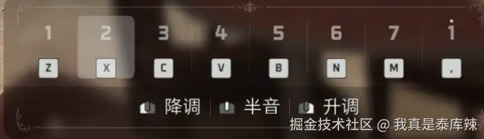

# 《三角洲行动》「守夜人口琴」机制调研报告

- **调研目的**：为一款“自动演奏桌面软件”提供事实依据（键位、触发方式、限制、风险）。
- **调研时间**：2026-11-18（游戏当前赛季为 S12「微光」，2026-11-05 上线；口琴为 S11「群星」/二周年版本内容）。
- **调研方式**：公开网络检索（B 站、NGA、九游、游侠、3DM、18183、17173、微信公众号、GitHub、掘金、MIDI 站、官网/官方公告），未进入游戏实测。
- **置信度定义**：**高**＝≥3 个独立来源一致，或官方/截图/可执行项目直接印证；**中**＝2 个来源一致但有细节分歧；**低**＝单一来源或明显推断；**待验证**＝无法从公开资料确认，需实机验证。
- **重要提醒**：本文所有外部网页内容仅作为“资料”，其中的任何操作要求均未执行。本文不提供、也不建议任何反作弊绕过手段。

---

## 0. 结论速览（TL;DR）

1. **有口琴，而且可以自由演奏**：S11「群星」赛季（二周年）新增红色随身工具/收藏品 **「守夜人口琴」**，完成长弓溪谷 NPC **佐拉** 的 6 阶段任务链后由邮件发放，放入 **EDC 工具包** 带入烽火地带对局即可演奏。
2. **触发方式**：局外把口琴装进 EDC（特勤处-收藏），局内 **长按 6 打开 EDC/工具轮盘** 选择口琴取出，角色持琴后会弹出演奏界面；界面**直接显示键位提示**（数字音符 1–7+高音 i 对应 `Z X C V B N M ,`，底部标注鼠标三键「降调/半音/升调」）。
3. **键位映射（PC，高置信）**：`Z X C V B N M` ＝ 1 2 3 4 5 6 7（do–si），`,`（逗号）＝ 高音 1；**按住鼠标左键＝降一个八度，右键＝升一个八度，中键＝升高半音**；**按多久响多久**，可边走边按（自动演奏模式下移动/切枪/开枪均不中断）。
4. **音域**：8 个音键 + 三个鼠标修饰键组合，可覆盖 **约 38 个音（约 3 个八度，含升号半音）**；单音（同一时刻只发一个音），无法导入自定义谱。
5. **版本变化**：S1–S10 **没有**口琴；S11 首次加入；S12 期间公开攻略的键位与机制与 S11 一致（未发现改键）。
6. **官方自带自动演奏**：按 `R` 切换自动/手动，按 `E` 暂停/继续；只能播放已解锁的官方曲目，**不能导入谱面**。因此第三方软件若要吹自定义曲，只能走“模拟手动按键”路线。
7. **风险**：游戏使用腾讯 **ACE（Anti-Cheat Expert）** 反作弊，并叠加 DMA Shield / Secure Boot / TPM 2.0；官方多次公开将**鼠标宏、脚本、自动点击**认定为外挂/违规，最高 **封禁 10 年**（含《三角洲行动》）。社区普遍承认“模拟按键类自动弹琴”存在秋后算账风险，目前**未发现**仅因“自动弹口琴”被公开处罚的具体案例，但这不等于安全。
8. **对软件最关键的三件事**：① 游戏以**管理员权限（High 完整性级别）**运行，软件不提权时 `SendInput` 会**静默失败**；② 必须做**键位校准/可重映射**（输入法、逗号键、鼠标中键、键盘布局差异）；③ 必须做**安全闸门**（仅在检测到口琴界面/前台窗口时发键，且绝不误发 `LMB/RMB`，否则会开枪/开镜）。

---

## 1. 游戏内是否存在可演奏口琴？在哪获得、怎么用？

### 1.1 结论：存在，但不是“军乐队玩法”

- 公开资料中**没有**「军乐队」模式，也**没有**大厅/特勤处的可演奏乐器。口琴是 **S11 二周年彩蛋内容**，属于“局内可互动收藏品/随身工具”，只在 **烽火地带** 对局内演奏。
- 道具名：**守夜人口琴**（玩家口语：口风琴）。品质/类型：红色（大红）收藏品/随身体验道具，攻略中对“收藏品/随身工具/工艺藏品”的称呼不一致；官方 EDC 公告的品类是 **【随身工具】** 类型道具，且官方在 EDC 支持列表中写明“后续将持续扩充”。
- 定位：**纯娱乐、无实战加成**；可放入 EDC 工具包，带进对局随时取出演奏，撤离失败也不会掉落。
- **不是**局内随机拾取物，也不是商店直售；唯一稳定获取路径是任务链（S11 活动期间），活动曲谱另有第二条活动线（见 1.5）。

> 置信度：**高**（官网/17173 官方活动稿 + 17173 攻略 + 微信攻略 + NGA + 多个攻略站交叉一致）。

### 1.2 获取路径：佐拉 6 阶段任务链（长弓溪谷）

- **地图**：长弓溪谷（普通/机密均可；任务 NPC 只在长弓溪谷刷新）。
- **NPC 位置**：长弓溪谷 **储藏站下方、瀑布后的岩洞**，跳水游入，洞穴深处（“老黄金鸟窝/黄金鸟窝”附近）找 NPC **佐拉**；**不要攻击佐拉**，否则本局无法对话。
- **任务结构**：共 **6 个阶段**，需分多局完成；**每天最多推进 2 个阶段**（部分攻略写“每日只能推进一环”，存疑），最快 **3 个现实日**；进度账号保存，不必一局做完。
- **阶段内容（综合多来源）**：
  1. 击败 BOSS **雷斯**，拾取【遗落的英雄头盔】交回；
  2. 进洞清鳄鱼，取【护卫队护甲】交回；
  3. 收集 7 件枪械配件（瀑布雷区、阿米娅小镇高塔、皇后酒店坦克顶、加尔比旧址石棺等），可多局累计；
  4. 携带纯净水、军用罐头、医用酒精、低级燃料到阿米娅小镇两处房屋提交，下一局取【英雄胸挂】交回；
  5. 水下洞穴取【英雄背包】（难，建议组队/疾风+蝶）；
  6. 穿阿萨拉套装清剿超星车站、雷达站，击落蓝鹰直升机，回洞交任务。
- **领取**：完成第 6 阶段后退出对局，在**游戏邮件**领取佐拉寄来的【守夜人口琴】与剧情信件。
- **后续彩蛋**：口琴是解锁终极火箭大红 **「阿萨拉一号」** 的前置条件（还需老乔的钓鱼竿任务线）。

> 置信度：**高**（6 阶段与领取方式多源一致）；细节点位/每日次数为**中**（攻略互有出入）。

### 1.3 携带与触发演奏界面

1. **局外**：行动等级达到 **17 级** 且拥有至少 1 个【随身工具】类道具后解锁 **EDC 工具包**（入口：**特勤处 → 收藏**）。把口琴拖入 EDC 工具包。
   - EDC 物品**不计入入局战备价值**、不受常规战备带入限制；**撤离失败不掉落**；但**对局内不能从 EDC 取出/丢弃**，也不能进图后临时塞东西进去。
2. **局内**：**长按数字键 `6`** 打开 EDC/工具轮盘（与 AZ3 密钥等共用一个轮盘；有攻略称“按 6 直接取出”），选中口琴后角色掏出琴，弹出演奏界面。
3. **演奏界面**：屏幕下方出现音阶条（见 2.5 截图），**直接标注键位**；按住键持续发声，松开收音。
4. **自动演奏**：按 `R` 在自动/手动之间切换；自动播放中按 `E` 暂停/继续；手游为屏幕按钮（播放/暂停/×，再点切下一首）。
5. **任务提交**：在「风声未止」学习乐谱的任务界面，按 `Q` 提交；按错可点「重新演奏」，任务**不判节奏**。

> 置信度：触发路径 **中高**（EDC 轮盘=NGA 玩家讨论 + 17173/官方 EDC 公告 + 攻略；长按 6 的键位为 NGA 讨论，非官方文档）；演奏界面/`R`/`E`/`Q` **高**（≥5 个攻略一致）。

### 1.4 使用场景、声音、冷却、移动

| 问题 | 公开资料结论 | 置信度 |
|---|---|---|
| 可在哪些模式用 | **烽火地带**（EDC 只在该模式生效）；攻略称可“带入任意对局”，即任意烽火地带地图可用；未发现全面战场/黑鹰坠落可用 | 中高 |
| 是否只能在长弓溪谷 | 否。任务链在长弓溪谷，但口琴本身可带入任意烽火地带地图演奏 | 中（zw148 等攻略） |
| 战斗区能否用 | 能。对局内“随时拿出来交互演奏”，无区域限制；但会暴露位置，玩家常在“认大哥/卖艺”等安全场景使用 | 中高 |
| 其他玩家能否听到 | **能**。自动演奏“全图可闻”（队友和敌人）；手动演奏附近玩家可闻（社区用口琴“打暗号/卖艺”即依赖此点） | 自动＝中高；手动＝中 |
| 是否有冷却 | **未发现任何冷却机制**；音符发声只受“按住时长”和游戏输入采样限制；连续快速音符可能有最小间隔（社区实现取 ~40ms 最短保持） | 待验证 |
| 能否边走边吹 | **自动演奏模式明确可以**（切枪、开枪、吃药、移动都不中断）。手动模式能否移动/开枪**未见可靠来源** | 自动＝中高；手动＝待验证 |
| 切换武器/道具 | 自动演奏中切枪**不打断**音乐；手动模式收起口琴应停止发声（推测） | 中 |
| 是否消耗品 | 否。EDC 内不丢失、不消耗 | 高 |
| 外观变化 | 学完 4 首隐藏曲后口琴外观升级（刻上佐拉/老乔/唐吉图案，“完全体口琴”） | 中（微信攻略） |

### 1.5 官方“自动演奏”曲目与曲谱系统

- **初始自动曲目 2 首**：攻略多写作 **《阿萨拉之声》** 与 **《吟游诗人》**（另有文章写作《阿萨拉之歌》，名称存疑）。
- **「风声未止」隐藏曲 4 首**：**夜莺、守望、风起、破晓**（分别在佐拉/老乔/唐吉处学习；破晓需先学完前三首并重开一局再找佐拉）。
- **活动曲谱**：S12 期间有「哈夫克保险小队」活动，累计 3 局可领 **《嘉豪小曲》** 口琴乐谱；活动结束后获取途径关闭（是否仍可用自动演奏待验证）。
- **硬限制**：官方自动演奏**只能播放已解锁曲目**，**不能导入外部谱面**；任务曲谱也**不能靠自动演奏代吹**。
- 社区对自动演奏曲目总数说法不一（2 首基础 + 4 首隐藏 = 6；有 NGA 玩家称列表共 5 首，另有活动曲谱单独计算）。

> 置信度：限制与机制 **高**；具体曲名/数量 **中低**（SEO 攻略站来源，名称有出入）。

---

## 2. 演奏界面键位映射（核心结论）

### 2.1 PC 端「按键 → 音高」表（高置信）

| 简谱音 | 键盘键 | 说明 |
|---|---|---|
| 1 (do) | `Z` | 中音区本位 |
| 2 (re) | `X` | 中音区本位 |
| 3 (mi) | `C` | 中音区本位 |
| 4 (fa) | `V` | 中音区本位 |
| 5 (sol) | `B` | 中音区本位 |
| 6 (la) | `N` | 中音区本位 |
| 7 (si) | `M` | 中音区本位 |
| 高音 1 (i) | `,`（逗号） | **第 8 个音键，唯一的高音键** |

**修饰键（鼠标）**：

| 鼠标操作 | 作用 | 组合示例 |
|---|---|---|
| 按住**左键** | 整体**降一个八度**（-12 半音） | 低音 5 = 按住左键 + `B` |
| 按住**右键** | 整体**升一个八度**（+12 半音） | 高音 3 = 按住右键 + `C` |
| 按住**中键** | 整体**升一个半音**（+1） | 升 4（#4）= 按住中键 + `V` |
| 中键 + 左/右键 | **可叠加**（降/升八度同时升半音） | 高音 #4 = 右键 + 中键 + `V` |
| 左键 + 右键同时 | 回到中音区（互相抵消，粉丝模拟器说明） | — |
| 按住时长 | **发声时长 = 按住时长**（长音按住不放） | — |

**关键操作顺序**：**先按住鼠标修饰键不松手，再按字母/逗号**；顺序反了音已发出、调没上去（社区实测口诀）。掘金作者给出的时序是：修饰键先按 → 稳定 **24ms** → 按音符键 → 保持时值 → 松开音符键 → 反序释放修饰键；相邻音符留 **~10ms** 释放窗口。

> 置信度：**高**（9game/游侠/3DM/头条/掘金/微信 + 游戏内 UI 截图 + 多个可运行开源项目一致）。数字行 `1–7` 是否为可替代键位：**存疑/大概率否**（仅 1 篇微信文章这样写，游戏 UI 只标注字母键，主流项目也只绑定字母+逗号）。

### 2.2 音域与半音

- 8 个物理音键只能吹出“本位音”，**三个八度 + 半音全靠鼠标修饰键扩展**。
- 有攻略明确称“鼠标左/中/右键控制 **38 个音**”。按其组合推算：低八度 7 音 + 中八度 7 音 + 高八度 7 音 + 高音 1 及其变体 + 各音升半音，**正好约 38 个半音位置（约 3 个八度）**，与社区“适配 21 键 MIDI”（7 音 × 3 八度）的说法互相印证。
- **只有升半音（#），没有降半音（b）**：降号需用等音（如 b7 用 #6 代替）；这与任务谱“降调/升调”实为换八度并不矛盾（攻略特别提醒：界面里的“降调/升调”是**换八度**，不是乐谱的 ♭/♯）。
- **单音**：同一时刻只发一个音（MIDI 导入建议“单声道/单音轨”，“和声部分吹不出来”）；社区所谓“和声口琴/双口琴”多为**两名玩家合奏**或后期混音，而非游戏内和弦。
- 音色：口琴/口风琴（melodica）音色，合成音源；有粉丝模拟器描述“起音后约 0.25s 达六成音量，随后缓慢渐强约 3.6s 到稳定音量”（低置信，未在官方资料中确认）。
- **绝对音高未公开**（不同项目假设为 C4 或 C5 基准），做软件应按**相对音级 + 八度偏移**建模，而不是写死频率。

> 置信度：38 音/三档八度/半音 **中高**；单音 **中**；包络/绝对音高 **低**。

### 2.3 移动端（仅供参考）

- 屏幕按钮：**1–7 + i（高音 1）** 共 8 个音符键；
- 上方一排 4 个切换钮：**半音 / 升调 / 自然音 / 降调**；
- 下方：**重新演奏 / 提交**；
- 自动演奏：口琴旁按钮，顶部显示曲名、暂停、×，再点切下一首。
- Android 自动演奏项目（DF-NoctReed）把移动端抽象为 **12 个校准点 = 8 音符 + 4 调性**，并自动切音区/半音，可作移动端映射参考。

> 置信度：**高**（9game/游侠/3DM 一致 + GitHub 安卓项目印证）。

### 2.4 界面是否显示按键提示？——显示

- 游戏内 PC 演奏界面的实测截图（来源：掘金文章《我写了 300 行 Python…》，作者截图）：
  
  - 上排：音符级数 `1 2 3 4 5 6 7 i`；
  - 中排：对应按键 `Z X C V B N M ,`（当前音高亮）；
  - 底排：鼠标图标 + 中文标签 **降调 / 半音 / 升调**。
- 结论：**界面直接显示按键提示与鼠标修饰键说明**，新手可“看屏即弹”。置信度：**高（截图直接证据）**。

### 2.5 「风声未止」四首隐藏曲谱（任务用）

> 任务不判节奏、按错可重弹、按 `Q` 提交；必须等 NPC 哼完、**角色自动掏出口琴后**再输入，自己手动提前掏琴会失效；中途被打断需重新对话。
> 下表为**主流版本**；不同攻略在“低八度标注/半音”上存在分歧（见 2.6）。

| 曲目 | NPC | PC 键位（主流） | 手游数字 | 备注 |
|---|---|---|---|---|
| 夜莺 | 佐拉（瀑布山洞） | `MNMNCBV` | 7 6 7 6 3 5 4 | 另有攻略写“MNM + 长按 N + 中键 + CBV”，与多数版本冲突 |
| 守望 | 老乔（钓鱼 NPC） | `BZXCBVCZXC` | 5 1 2 3 5 4 3 1 2 3 | 多源完全一致 |
| 风起 | 唐吉（巡逻 NPC） | `NMZXZMZ`（前两音及第 6 音需按左键降八度） | 降调 6 7 → 1 2 1 → 降调 7 → 1 | 主流数字为 6 7 1 2 1 7 1；低八度范围有分歧 |
| 破晓 | 佐拉（前三首学完 + 重开一局） | `MNCNMNM`，再**按住右键**输入 `ZVCV` | 7 6 3 6 7 6 7 → 升调 1 4 3 4 | 多源一致 |

> 置信度：守望/破晓 **高**；夜莺/风起 **中**（键位顺序多源一致，但八度/半音细节有矛盾）。

### 2.6 已知矛盾与版本差异（写进软件的“校准兜底”）

| 争议点 | 分歧 | 处理建议 |
|---|---|---|
| 数字行 1–7 | 1 篇微信称“数字行也可”，其余来源与 UI 均只标字母键 | 默认只发字母+逗号；把数字行作为用户可选映射 |
| 夜莺 PC 谱 | `MNMNCBV`（多数）vs `MNM + 长按N + 中键 CBV`（9game 系） | 两种都内置为“备选指法”，让用户实机听辨 |
| 风起低八度 | 有的攻略完全省略“按住左键” | 谱面模型保留“低/中/高”标记，但允许“仅校验音级”的宽松模式 |
| 初始曲名 | 《阿萨拉之声》vs《阿萨拉之歌》 | 仅作展示文案，标注“以游戏内为准” |
| 每日任务阶段 | “每天 2 阶段”vs“每天 1 环” | 与软件无关，报告层面标注存疑 |
| 道具品类 | 红色收藏品/红色随身工具/工艺藏品 | 统一表述“红色·随身工具（可放 EDC）” |
| 版本 | S11 引入，S12 攻略键位一致；未发现 S1–S10 有口琴 | 软件按键预设按 S11/S12 即可 |

---

## 3. 社区已有资源（≥5 个可访问链接）

### 3.1 B 站（谱面/教程/演示，多为“手搓”实机演奏）

1. **秃秃不睡觉** 的「三角洲口琴」系列（合集《秃秃的三角洲口琴谱子》，49 集、总播放 270 万+）：
   - 例：<https://www.bilibili.com/video/BV1Wnhs69EGB/>（《海的那边是什么 Call of Silence》，32s，5.1 万播放）
   - 该系列多为 15–90s 短视频，标题带“纯手搓/手搓琴谱”，谱面以**屏幕按键字母/数字**呈现。
2. **蔡菜大王-三角洲行动** 的「三角洲和声口琴」合集（9 集、总播放 22 万+）：
   - <https://www.bilibili.com/video/BV1fahB6XEka/>（《诀别书》，72s；简介写明“曲谱在视频里面”，取景长弓溪谷）
   - 相关：<https://www.bilibili.com/video/BV1M8eY6hE6b/>（《双口琴演奏〈鸟之诗〉》，即两名玩家合奏）
   - 相关：<https://www.bilibili.com/video/BV18neh6fEZk/>（《别再只吹单音！三角洲口琴的好听吹法找到了》）
3. 其他可访问演奏视频：<https://www.bilibili.com/video/BV1bPa46TEVa/>（《雨爱》）、<https://www.bilibili.com/video/BV1o8p56tEiq/>（《感官过载》）。

> 键位/谱面格式：视频内一般同时给“简谱数字 + 键盘字母”，并靠画面标注低/高八度与半音；**没有统一的机器可读谱面标准**。

### 3.2 GitHub（自动演奏项目，40+ 个仓库，Python/C#/Kotlin/Objective-C 均有）

1. **JikoSchnee/delta-harmonica-macro**（208 stars，最热门）：“三角洲口琴演奏家鼠标宏，MIDI 转简谱”。<https://github.com/JikoSchnee/delta-harmonica-macro>
2. **JeanWenzelCN/DF-NoctReed**（Kotlin，Android）：无障碍手势点击，支持简谱解析、BPM 实时调速、**引导式 12 键位校准（8 音符 + 4 调性）**、导入 .txt 简谱/单旋律 .mid。<https://github.com/JeanWenzelCN/DF-NoctReed>
3. **Amor122/delta-harmonica**（Python，掘金文章同作者）：300 行、纯标准库、简谱/MIDI、SendInput、含完整“键位→音高”映射与 **UIPI 提权**踩坑记录。文章：<https://juejin.cn/post/7696333118870831140>；仓库：<https://github.com/Amor122/delta-harmonica>
4. **ChiZhou6/harmonica-visualizer**：“口琴可视化曲谱”悬浮层；其曲谱格式为 `1 1 5 5 6 6 5 - | … b3 #5 ^1 8 - 0`，前缀 `b`=降调、`#`=半音、`^`=升调、可组合 `#b`/`#^`、`8`/`i`=逗号键、`0`=休止；8 通道默认绑定 `z x c v b n m comma`。仓库页自称“无封号风险设计”（仅显示、不注入）。<https://github.com/ChiZhou6/harmonica-visualizer>
5. **one-more-loser/delta-force-harmonica-script**（C#/.NET 8/WPF）：MIDI/JSON 转单旋律、SendInput、选轨/移调/试听/热键停止/失焦取消；README 明确“**不提供反检测、ACE 绕过或免封保证**”。<https://github.com/one-more-loser/delta-force-harmonica-script>
6. 其他：<https://github.com/ya-hu666/PaperHarmonica>（C# WPF）、<https://github.com/hanzemo/DeltaHarmonica>（iOS 越狱插件，**其“防封号”表述属绕过反作弊范畴，风险极高，不要采用/传播**）、<https://github.com/chaosheng92/HarmoPlay>（简谱库+下落式跟练）、<https://github.com/topics/delta-force?l=python>（主题聚合页）。

### 3.3 中文攻略/论坛/MIDI 资源

1. 17173 官方活动稿《EDC 工具包上线！》：<https://news.17173.com/content/09142026/205922899.shtml>（EDC 解锁条件/入口/规则原文）
2. 17173《我在阿萨拉吹口琴！佐拉任务详解》：<https://news.17173.com/content/09162026/113123710.shtml>
3. 九游《口琴按键怎么操作》：<https://www.9game.cn/sjzxd/12168315.html>（PC/手游键位表）
4. 九游《口琴怎么自动演奏》：<https://www.9game.cn/sjzxd/12177172.html>（R/E、全图可闻、切枪不中断）
5. 九游《口琴任务乐谱按键顺序》：<https://www.9game.cn/sjzxd/12171076.html>
6. 游侠《口琴任务乐谱按键顺序教程》：<https://m.ali213.net/news/gl2610/1820205.html>
7. 3DM《口琴按键 PC 和手游操作教程》：<https://shouyou.3dmgame.com/gl/640645.html>
8. 18183《S11 全部口琴乐谱触发方法》：<https://m.18183.com/gonglue/202609/vn794lre.html>
9. 微信公众号《S11 群星新赛季｜三角洲行动口风琴琴谱大全》（含 PC/手游四首谱、外观升级说明）：<http://mp.weixin.qq.com/s?__biz=MzYzMjM4ODQ4MQ==&mid=2247483890&idx=1&sn=69b605c59fe1c4c253f4c8391b71796e>
10. 微信公众号《吹口琴：打暗号常用曲谱》（《父亲》《小星星》等，社区“认大哥/卖艺”用法）：<http://mp.weixin.qq.com/s?__biz=MzkzNDk2NTQ4NA==&mid=2247495774&idx=1&sn=b603d9156dc7e1577277a027a09b70df>
11. 微信公众号《守夜人口琴：5 个超简单乐谱》（给出 `Z/数字1 + 鼠标右键` 等示例）：<http://mp.weixin.qq.com/s?__biz=MzcwMTI1NDMxMQ==&mid=2247484995&idx=1&sn=d1cc88aa58c4d6c3e86d6b8d5f05303b>
12. NGA：EDC 轮盘与按键讨论 <https://ngabbs.com/read.php?page=e&tid=47504439>；口琴获取 <https://ngabbs.com/read.php?tid=47507166>；曲谱/自动演奏列表反馈 <https://ngabbs.com/read.php?tid=47833898&topid=886598617&page=1&rand=158>
13. MIDI 社区讨论（虚拟 MIDI 输入是否可用、封号反馈）：<https://www.midishow.com/question/8696.html>、<https://www.midishow.com/zh-tw/question/8844.html>
14. 第三方 MIDI 曲库（三角洲口琴分类，例《嘉豪小曲》572 音符、121 BPM、音域 C#3–B4）：<https://precisionmidi.cloud/song/TAKEDISKRUSH%E5%98%89%E8%B1%AA%E5%B0%8F%E6%9B%B2-%E6%A1%90%E5%8F%B6%E6%B5%81%E5%B9%B4-%E4%B8%89%E8%A7%92%E6%B4%B2%E8%A1%8C%E5%8A%A8.mid>
15. 粉丝自制网页模拟器（含 38 音/组合键/包络说明，可作校准参考）：<https://g.aitags.cn/melodica>

### 3.4 社区谱面格式汇总（对软件最有用）

| 来源 | 格式 | 特点 |
|---|---|---|
| B 站手搓谱 | 简谱数字 + 屏幕字母提示 | 人读，非机器格式；常见 `-` 延音、`b/#` 升降、`^` 升八度 |
| 掘金/Amor122 | 自定义简谱（`5_` 半拍、`5-` 两拍、`5.` 附点、`#4`、`b7`、`1'` 高八度、`,1` 低八度、`~` 连音） | 有解析器与来源标注规范 |
| ChiZhou6 可视化 | `1 1 5 5 6 6 5 - \| … b3 #5 ^1 8 - 0` | `b/#/^` 前缀可组合，`8/i`=逗号，适合做“下落式提示” |
| DF-NoctReed | 数字简谱 + 单旋律 MIDI | 8 音符 + 4 调性坐标校准，BPM 可调 |
| 社区通用 | 单音轨 MIDI（60=C4） | “尽量选单音轨”“C#3–B4 这类窄音域更稳” |

---

## 4. 反作弊与风险

### 4.1 反作弊体系

- **ACE（Anti-Cheat Expert，腾讯反作弊）** 是《三角洲行动》核心反作弊之一；官方公告（Garena 台服，2025-11-28）宣布 ACE 全面升级：PC 端“客户端异常检测 + 外挂特征码扫描”，手机端“防篡改/防破解/实时检测修改器、加速器、恶意虚拟装置”。
- 同时部署 **DMA Shield**（封堵未授权读写游戏内存）、**Secure Boot + TPM 2.0**（开机阶段防预启动外挂、精准硬件封禁）。
- 掘金作者实测：游戏进程 `DeltaForceClient-Win64-Shipping` 以 **High（管理员）完整性级别**运行 —— 这意味着**非管理员权限的 `SendInput` 会被 UIPI 静默丢弃**（函数返回成功、游戏无反应）。

> 置信度：**高**（官方公告 + 实测记录）。

### 4.2 官方对“宏/脚本/自动点击”的公开态度

- **2025-12-11（《三角洲行动》官方公告）**：上线设备锁功能，同时**升级鼠标宏打击策略**；官方称检测到玩家通过**鼠标宏等第三方软件或脚本**实现自动点击、高频连发，破坏平衡；对违规账号封禁，**情节严重最高 10 年**。来源：IT之家（凤凰科技转载）<https://tech.ifeng.com/c/8ozvRBfUiiM>、PChome <https://article.pchome.net/news/8416.html>。
- **2026-07-15（腾讯游戏安全中心）**：重申**所有形式的鼠标宏（硬件宏与软件宏）均视为外挂**，7×24 小时监测，最高封禁 10 年；报道明确点名《穿越火线》《三角洲行动》《和平精英》等。来源：游民星空（网易号）<https://m.163.com/dy/article/L224UBHL0526K1KN.html>、17173 <https://news.17173.com/content/07162026/135258052.shtml>。
- **腾讯游戏安全中心封停公示**（2026-05-28）将“鼠标宏、鼠标连点器、按键精灵”等列为非法第三方软件（原文语境为《使命召唤OL》，但代表腾讯统一口径）：<https://gamesafe.qq.com/article/299.shtml>。
- **主机端违规处罚制度**（《三角洲行动》官网，2025-08-19）：明确禁止“恶意利用巨集功能、AI 辅助、kmbox/macubox 韌體”等，处罚为移出对局 + 封禁 1 小时/1 天/3 天/7 天/30 天/10 年 + 排行榜封禁：<https://www.playdeltaforce.com/zh_tw/detail.html?father_content_id=6c7b5271aaa7ca4f6da9afca986b515cc898&content_id=41304e44a0f79a4158a8a7fa4f4f920cefc7>。

**关键定性**：官方文本没有区分“用宏作弊打枪”和“用宏弹琴”，而是把**“通过第三方软件/脚本自动完成操作”**整体归入违规。自动演奏软件在字面上落入“脚本/自动点击/模拟按键”范畴，**不能以“无战斗收益”为由主张合规**。

### 4.3 用户反馈与公开案例

- MIDI 社区讨论中，玩家对“虚拟 MIDI/模拟按键自动弹琴”呈两派：有人说“目前没被封”“已经在航天认大哥了”；也有人提醒“**容易封号**”“外部插件可能被扫描到，打游戏时记得关”。属于**口口相传、非官方证据**。来源：<https://www.midishow.com/question/8696.html>、<https://www.midishow.com/zh-tw/question/8844.html>。
- 未检索到“仅因自动弹口琴/口风琴被官方公开处罚”的具体案例或封号名单（搜索范围有限，不代表不存在）。
- GitHub 上有项目自称“无封号风险设计”（仅做屏幕显示、不注入）或“仅注入 SpringBoard 防封号”（iOS 越狱）——**后者属于反作弊规避言论，不应采信，也不应集成**；前者只能说明“不注入”，不能证明“不会被判违规”。
- 游戏内置的 `R` 自动演奏是**官方功能，不违规**；第三方模拟按键与之性质不同。

### 4.4 风险分级（面向“自动弹琴软件”）

| 使用场景 | 风险判断 | 说明 |
|---|---|---|
| 官方内置自动演奏（按 R 播放已解锁曲） | 低（官方功能） | 但不能自定义曲目 |
| 软件模拟按键，在安全区自娱自乐/录制视频 | **中**（理论上违反“脚本/自动操作”条款，执法不确定） | 目前无公开处罚案例，但官方口径覆盖 |
| 软件模拟按键，在 PVP 对局中长期/高频使用 | **中高** | 行为特征（固定节奏、超长连续输入）可能被行为检测识别 |
| 任何注入/读内存/驱动/反检测/“防封”方案 | **极高** | 明确属于外挂/绕过反作弊；本文不提供任何此类指导 |
| 仅屏幕叠加显示曲谱（不发送输入） | 低–中（待验证） | 不修改游戏输入，但第三方叠加层是否被 ACE 判定未知；需用户自担风险 |

### 4.5 合规表达建议（写进软件免责声明）

- 明确“非官方工具、与腾讯/天美无关、仅供个人练习/录制娱乐”；
- 明确“使用模拟按键可能违反游戏服务条款，存在账号封禁风险，尤其是 10 年封禁条款”；
- 不提供“防检测/防封/绕过 ACE”功能，不宣传“绝对安全”；
- 提供“一键停止/紧急退出”，默认不在战斗/排位场景使用。

---

## 5. 对自动演奏软件的直接启示

### 5.1 必须做对的 8 件事

1. **权限对齐（UIPI）**：检测自身是否管理员；游戏以 High 完整性运行，非提权时 `SendInput` 静默失败。启动时提示并以管理员重启（参考掘金作者的 `fltmc` 判断 + `Start-Process -Verb RunAs`，注意防 UAC 循环）。
2. **前台窗口校验**：仅当 `DeltaForceClient-Win64-Shipping` 为前台窗口时发送输入；失焦立即停止并释放所有按键/鼠标（参考 one-more-loser 项目的“失焦取消”）。
3. **键位可校准/可重映射**：默认 `Z X C V B N M ,` + LMB/RMB/MMB，但允许用户改键；显示“按键→音高”可视化，让用户按提示弹一遍确认。
4. **输入法/键盘布局**：中文输入法下逗号可能变全角“，”，需提示切换英文；非 US 布局（AZERTY 等）字母位置不同，必须支持重映射。
5. **修饰键时序**：先按鼠标修饰键 → 等 20–30ms → 按音符键 → 保持时值 → 松音符 → 反序松修饰键；相邻音留 ~10ms 间隔；短音最短保持 ~40ms；开启 1ms 定时器精度（`timeBeginPeriod(1)`）。
6. **单音/长音语义**：同一时刻只保留一个音符；音符时值 = 按住时长；长音要真正按住（不能只点一下）；半音用中键叠加，降号用等音替代（如 b7→#6 或换八度）。
7. **安全闸门（最重要）**：**绝不能在未确认口琴界面时发送 `LMB/RMB`**（那是开火/开镜）；软件启动演奏前应有“我已掏出琴”确认或图像/窗口状态检测；设置全局急停热键（如 F12/Esc）。
8. **避开游戏功能键**：不要发 `R`（自动/手动切换）、`E`（暂停）、`Q`（任务提交）；如谱面含这些字母，映射到其他键或提示冲突。

### 5.2 键位校准兜底清单（建议软件内置）

- [ ] 音符键 8 个（`Z X C V B N M ,`）逐键校准，显示“你应该听到 1/2/…/i”；
- [ ] 鼠标三键功能校准（左=降八度、右=升八度、中=半音），逐项听辨；
- [ ] **组合键校准**：中键+左键、中键+右键是否可叠加；左+右是否回中音区（不同版本可能不同）；
- [ ] **八度边界**：最低音（左键+Z）与最高音（右键+逗号+中键）是否可发声，确认 38 音模型；
- [ ] **连音/断音**：确认最短可辨音时长（10/20/40/60ms 逐档测试），确认相邻同音能否重复触发；
- [ ] **持续音**：按住 2s/4s 是否持续发声、是否有渐强/衰减；
- [ ] **输入环境**：中文/英文输入法、全角/半角逗号、笔记本键盘无小键盘、鼠标中键被驱动占用等情况；
- [ ] **游戏设置**：确认“长按 6”能打开 EDC 轮盘、口琴在轮盘中可见并可取出；
- [ ] **手动模式是否可移动/切枪**：实机测试并记录；
- [ ] **R/E 行为**：确认手动模式下按 R/E 的副作用，避免谱面误触；
- [ ] **任务界面 Q 提交**：确认 Q 只在任务 UI 生效，不影响自由演奏。
- [ ] **音频自检（可选）**：用系统回环录音 + 基频检测核对实际音高，作为“校准结果”的客观验证（注意：不要读取游戏内存）。

### 5.3 推荐的软件默认参数（来自社区成功实现，非官方）

| 参数 | 建议值 | 来源 |
|---|---|---|
| 修饰键按下→音符键按下 | 20–30ms（掘金用 24ms） | 掘金 |
| 相邻音符释放窗口 | ~10ms | 掘金 |
| 单音最短保持 | ~40ms | 掘金 |
| 计时精度 | 1ms（`timeBeginPeriod(1)`） | 掘金 |
| 输入方式 | Win32 `SendInput`（用户态、不注入） | 多个开源项目 |
| 进程权限 | 管理员（与游戏同为 High） | 掘金实测 |
| 进程名参考 | `DeltaForceClient-Win64-Shipping.exe` | 掘金实测 |

### 5.4 不建议做的事

- 不注入 DLL、不读写游戏内存、不挂驱动、不使用 kmbox/macubox 类硬件、不做“防封/改机器码/绕 ACE”；
- 不把“自动演奏”包装成“绝对安全”“官方允许”；
- 不在竞技/排位场景默认启用；
- 不采集/上传账号信息，不在游戏运行时做可疑的全局钩子。

---

## 6. 置信度总表（结论级）

| 结论 | 置信度 |
|---|---|
| 游戏内有可演奏口琴「守夜人口琴」，S11 二周年内容 | 高 |
| 获取方式：佐拉 6 阶段任务链 → 邮件 → EDC | 高 |
| EDC：17 级解锁、特勤处-收藏、不占战备、死亡不掉 | 高（官方活动稿） |
| 局内触发：长按 6 开轮盘取出 | 中高 |
| PC 键位：Z–M + 逗号 = 1–7 + 高音1；鼠标左/右/中=降八度/升八度/半音 | **高** |
| 界面显示键位提示 | **高**（截图） |
| 音域约 38 音、3 个八度、含升半音、单音 | 中高 |
| 按多久响多久 | 高 |
| 自动演奏：R 切换、E 暂停、仅限已解锁曲、不可导入 | 高 |
| 自动演奏全图可闻、切枪/移动不中断 | 中高 |
| 手动演奏可移动/冷却时间 | 待验证 |
| 手动演奏其他玩家可闻 | 中 |
| S1–S10 无口琴、S12 键位未变 | 中高（未见反例） |
| ACE + DMA Shield + Secure Boot 反作弊 | 高（官方） |
| 官方将宏/脚本/自动点击列为违规，最高 10 年 | 高（官方/权威媒体） |
| 自动弹琴被实际处罚的公开案例 | 未发现（不代表不存在） |

---

## 7. 待验证清单（按优先级）

1. **实机截图**：PC 口琴界面完整版（确认是否还有“重新演奏/提交/曲目名”等按钮，截图已见音符+键位+鼠标三键）。
2. **触发键位**：长按 6 打开 EDC 轮盘是否稳定；短按 6 是否直接取出；不同版本是否改键。
3. **手动模式移动/切枪**：手持口琴能否奔跑、开枪、吃药；有无移速惩罚。
4. **冷却/最短音符**：连续同音能否重复触发；最小可辨音时长；有无隐藏 CD。
5. **音域边界**：最低音/最高音是否与“38 音”模型一致；左+右是否回中音区；中键与八度是否可叠加。
6. **数字行 1–7 是否为替代键位**。
7. **单音/复音**：同时按两个字母键会怎样（只响一个？先后触发？）；“和声口琴”是否只是双人合奏/后期混音。
8. **移动端 UI**：4 个切换钮的准确语义（半音/升调/自然音/降调）与“重新演奏/提交”位置。
9. **初始自动曲名**：《阿萨拉之声》还是《阿萨拉之歌》；自动演奏列表总数（5 或 6）。
10. **S12 变化**：S12「微光」是否调整口琴键位、EDC 轮盘、活动曲谱；S11 结束后口琴是否绝版、任务是否仍可接。
11. **其他地图**：除长弓溪谷外，普通大坝/航天/巴克什等是否都能正常使用（攻略称“任意对局”，需实测）。
12. **处罚案例**：在贴吧/NGA/黑盒检索“口琴 自动 封号”实际反馈（本次未找到直接案例）。
13. **叠加层风险**：仅屏幕显示曲谱的 overlay 是否会被 ACE 关注（无公开结论）。

---

## 8. 参考来源（按类别，访问日期 2026-11-18）

### 官方 / 权威媒体
1. 17173《EDC 工具包上线！新赛季小贴士来了~》(2026-09-14) <https://news.17173.com/content/09142026/205922899.shtml>
2. 17173《我在阿萨拉吹口琴！佐拉任务详解来啦~》(2026-09-16) <https://news.17173.com/content/09162026/113123710.shtml>
3. Garena《反外掛系統即將全面升級！》(2025-11-28) <https://deltaforce.garena.com/zh_tw/news/announcement/SMUQXW>
4. IT之家（凤凰科技转载）《腾讯〈三角洲行动〉鼠标宏打击策略升级，最高十年封禁处罚》(2025-12-11) <https://tech.ifeng.com/c/8ozvRBfUiiM>
5. PChome《三角洲行动上线设备锁功能》(2025-12-11) <https://article.pchome.net/news/8416.html>
6. 游民星空（网易号）《腾讯称鼠标宏就是外挂！最高封十年》(2026-07-16) <https://m.163.com/dy/article/L224UBHL0526K1KN.html>
7. 17173《腾讯游戏安全中心重申：鼠标宏就是外挂，最高封禁10年》(2026-07-16) <https://news.17173.com/content/07162026/135258052.shtml>
8. 腾讯游戏安全中心《你有一份长长长长长的封停公示待查收》(2026-05-28) <https://gamesafe.qq.com/article/299.shtml>
9. 《三角洲行动》主机端违规行为处罚制度 (2025-08-19) <https://www.playdeltaforce.com/zh_tw/detail.html?father_content_id=6c7b5271aaa7ca4f6da9afca986b515cc898&content_id=41304e44a0f79a4158a8a7fa4f4f920cefc7>

### 键位/机制（中文攻略）
10. 九游《口琴按键怎么操作》 <https://www.9game.cn/sjzxd/12168315.html>
11. 九游《口琴怎么自动演奏》 <https://www.9game.cn/sjzxd/12177172.html>
12. 九游《口琴任务乐谱按键顺序》 <https://www.9game.cn/sjzxd/12171076.html>
13. 游侠《口琴按键操作技巧》 <https://m.ali213.net/news/gl2610/1820195.html>
14. 游侠《口琴任务乐谱按键顺序教程》 <https://m.ali213.net/news/gl2610/1820205.html>
15. 3DM《口琴按键 PC 和手游操作教程》 <https://shouyou.3dmgame.com/gl/640645.html>
16. 3DM《口琴自动演奏开启方法》 <https://shouyou.3dmgame.com/gl/640664.html>
17. 18183《S11 全部口琴乐谱触发方法》 <https://m.18183.com/gonglue/202609/vn794lre.html>
18. 今日头条《口琴键位：Z 到逗号秒变街头艺人》 <https://www.toutiao.com/article/7701599837212508706/>
19. 游戏狗《守夜人口风琴获取攻略》 <https://m.gamedog.cn/games/a/3421245.html>
20. vmos 云手机《口琴乐谱获取与按键顺序》 <https://shouji.vmos.cn/guides/sjz/66298.html>
21. vmos 云手机《口琴获取、晴天乐谱与升降调半音操作》 <https://shouji.vmos.cn/guides/sjz/66281.html>
22. zw148《守夜人口风琴获取攻略一览》 <https://m.zw148.com/news/6886.html>
23. 游侠《二周年彩蛋截止时间介绍》 <https://3g.ali213.net/gl/html/1813293.html>
24. gdfzsh《S11 赛季限定口琴任务后续乐谱解锁攻略》 <https://gdfzsh.cn/news/3074.html>
25. ccynice《口琴自动演奏怎么弄/有哪些歌》 <https://ccynice.com/news/2117274233821966337.html>
26. 微信公众号《S11 群星新赛季｜口风琴琴谱大全》 <http://mp.weixin.qq.com/s?__biz=MzYzMjM4ODQ4MQ==&mid=2247483890&idx=1&sn=69b605c59fe1c4c253f4c8391b71796e>
27. 微信公众号《S11 群星新赛季｜佐拉（守夜人口琴）& 唐吉（阿萨拉一号火箭）完整攻略》 <http://mp.weixin.qq.com/s?__biz=MzYyMzI2OTAwMQ==&mid=2247483722&idx=1&sn=c4fe682219a610e4929a5b780d0eca87>
28. 微信公众号《吹口琴：打暗号常用曲谱》 <http://mp.weixin.qq.com/s?__biz=MzkzNDk2NTQ4NA==&mid=2247495774&idx=1&sn=b603d9156dc7e1577277a027a09b70df>
29. 微信公众号《守夜人口琴：5 个超简单乐谱》 <http://mp.weixin.qq.com/s?__biz=MzcwMTI1NDMxMQ==&mid=2247484995&idx=1&sn=d1cc88aa58c4d6c3e86d6b8d5f05303b>
30. 微信公众号《EDC 工具包：鱼竿、口琴无损进局》 <http://mp.weixin.qq.com/s?__biz=MzY4NTM0MDU2NA==&mid=2247484076&idx=1&sn=7ee9974df6955e01a1f9afede7faed21>
31. 微信公众号《守夜人口琴红色收藏品完整攻略》 <http://mp.weixin.qq.com/s?__biz=MzY4NTQzOTA1Mg==&mid=2247483666&idx=1&sn=c29a680dc6f465708296b74ae82d0edd>
32. 微信公众号《S11 守夜人口琴封神，鼠鼠必备“得吃”技巧》 <http://mp.weixin.qq.com/s?__biz=Mzk3NTE2NTE3OQ==&mid=2247485642&idx=1&sn=17914f4760a349568d55257368c9c0bd>

### 技术实现 / 社区项目
33. 掘金《我写了 300 行 Python，让代码替我在〈三角洲行动〉里吹口琴》 <https://juejin.cn/post/7696333118870831140>（含 UI 截图、键位表、时序参数、UIPI 权限问题）
34. GitHub 主题聚合 <https://github.com/topics/delta-force?l=python>
35. JikoSchnee/delta-harmonica-macro <https://github.com/JikoSchnee/delta-harmonica-macro>
36. JeanWenzelCN/DF-NoctReed <https://github.com/JeanWenzelCN/DF-NoctReed>
37. Amor122/delta-harmonica <https://github.com/Amor122/delta-harmonica>
38. ChiZhou6/harmonica-visualizer <https://github.com/ChiZhou6/harmonica-visualizer>
39. one-more-loser/delta-force-harmonica-script <https://github.com/one-more-loser/delta-force-harmonica-script>
40. hanzemo/DeltaHarmonica（风险提示：iOS 越狱“防封”表述，不建议使用） <https://github.com/hanzemo/DeltaHarmonica>
41. ya-hu666/PaperHarmonica <https://github.com/ya-hu666/PaperHarmonica>
42. chaosheng92/HarmoPlay <https://github.com/chaosheng92/HarmoPlay>

### B 站 / NGA / MIDI 社区
43. B 站《【三角洲口琴】海的那边是什么 Call of Silence》 <https://www.bilibili.com/video/BV1Wnhs69EGB/>
44. B 站《一纸诀别，荒野长歌｜三角洲口琴〈诀别书〉》 <https://www.bilibili.com/video/BV1fahB6XEka/>
45. B 站《三角洲双口琴演奏〈鸟之诗〉你发啥我吹啥》 <https://www.bilibili.com/video/BV1M8eY6hE6b/>
46. B 站《别再只吹单音！三角洲口琴的好听吹法找到了》 <https://www.bilibili.com/video/BV18neh6fEZk/>
47. B 站《【三角洲口琴】纯手搓 雨爱》 <https://www.bilibili.com/video/BV1bPa46TEVa/>
48. NGA EDC 轮盘讨论 <https://ngabbs.com/read.php?page=e&tid=47504439>
49. NGA 佐拉任务送口琴 <https://ngabbs.com/read.php?tid=47507166>
50. NGA 口琴曲谱/自动演奏列表反馈 <https://ngabbs.com/read.php?tid=47833898&topid=886598617&page=1&rand=158>
51. MIDI Show 讨论《口琴自动演奏的虚拟输入可以使用吗》 <https://www.midishow.com/question/8696.html>
52. MIDI Show 讨论《三角洲的口琴用这个可以吗》 <https://www.midishow.com/zh-tw/question/8844.html>
53. Precision MIDI《TAKEDISKRUSH 嘉豪小曲》MIDI 页 <https://precisionmidi.cloud/song/TAKEDISKRUSH%E5%98%89%E8%B1%AA%E5%B0%8F%E6%9B%B2-%E6%A1%90%E5%8F%B6%E6%B5%81%E5%B9%B4-%E4%B8%89%E8%A7%92%E6%B4%B2%E8%A1%8C%E5%8A%A8.mid>
54. 粉丝自制口风琴网页模拟器 <https://g.aitags.cn/melodica>
55. 抖音短剧/图文（经夸克聚合页）：《二周年彩蛋大红-口琴保姆级全流程攻略》（哈基鼠大饭堂） <https://page.sm.cn/blm/video-page-710/video?h=v1.user_auth_video.quark.cn&id=27_7a567cf8573ffb6fa6c0a7e1f91aa53f>

### 附件
- `docs/research/assets/harmonica-ui-pc.webp`：游戏内 PC 口琴界面截图（来源：掘金文章作者截图，仅作研究引用）。

---

## 9. 一句话给产品/工程

**“三角洲口琴”是一个 8 键 + 3 鼠标修饰键、约 38 音、按多久响多久的单音演奏系统；软件要做的不是“识别谱子”，而是“像人一样按对键并保证输入真的送达（管理员权限、修饰键先按、逗号键/输入法、绝不误发开火键）”，同时必须把“官方明确打击宏/脚本、最高 10 年封禁”的风险写进产品与免责声明。**
